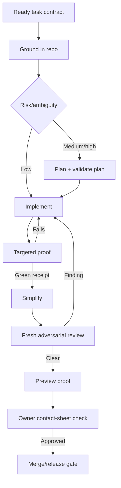

# How to run this SaaS well with Claude Code

**Research date:** 2026-09-16  
**Project:** Multi-tenant SaaS for car detailers (React/Vite, Supabase, Netlify, Resend, Stripe)  
**Operating constraint:** One non-programmer owner; no dependable line-by-line human code review

## Executive judgment

The single highest-payoff change is to make every completed task carry **proof that the checks actually exercised what they claim**.

Today a script can print “clean” after visiting zero routes, skipping its assertions, rendering the fallback language, or querying only the tenant it was seeded with. That makes the rest of the process—roadmaps, reviewer agents, design skills, and even a large test suite—unsafe. The new rule should be:

> No green verdict without a machine-readable receipt showing targets discovered, targets attempted, targets completed, assertions executed, skips, failures, identities/locales/viewports used, and artifacts produced. A new or materially changed check is not trusted until a controlled defect makes it fail.

Call this **proof-carrying work**. It is more important than adding another review skill, writing a longer specification, or increasing test count.

### Ranked recommendations

| Rank | Recommendation | Expected payoff | Why it matters here |
|---:|---|---|---|
| 1 | Replace pass/fail prose with proof-carrying verification receipts and negative controls | Transformational | Directly fixes the project’s repeated false-green failure mode |
| 2 | Prove tenant isolation as a matrix, at the database boundary, for every tenant-owned object | Transformational | A single leak can end the product; UI checks cannot prove isolation |
| 3 | Cut documentation to a small, typed, lifecycle-managed set; delete session debris from the working tree | Very high | 930,000 words actively lower agent reliability and preserve stale claims |
| 4 | Make each roadmap item an executable contract with invariants, acceptance criteria, proof commands, and rollback | Very high | Lets a cold session work without reinterpreting the audit |
| 5 | Use risk-ordered vertical slices: security/data integrity, core booking behavior, deploy integrity, then UX polish | High | Prevents polishing surfaces built on unsafe or unverifiable foundations |
| 6 | Put guarantees in hooks/CI; keep judgment and conditional workflows in skills | High | File instructions are advisory; deterministic gates are enforceable |
| 7 | Use one design generator and one independent design critic, both constrained by the project’s design system | High | A pile of overlapping taste skills produces inconsistent “houses,” not quality |
| 8 | Connect agents only to scoped development/sandbox services; production access should be read-only and exceptional | High | MCP convenience expands the blast radius of prompt or agent mistakes |
| 9 | Add structural checks and real-boundary tests, not just more unit tests | Medium-high | AI code often passes behavior tests while violating architecture or mocking reality |
| 10 | Reserve subagents for bounded investigation and independent verification | Medium | They preserve context and add perspective, but coordination and summary loss are real costs |

### Evidence labels used in this report

- **Primary** — vendor documentation, standards, or the tool’s own repository.
- **Empirical** — published study, benchmark, or large measured dataset. Preprints are identified as such.
- **Practitioner** — experienced maintainers or designers describing observed patterns; useful, but not controlled evidence.
- **Recommendation** — my conclusion for this project, combining the evidence with its unusual human-review constraint.

---

## 1. Documentation: keep a control plane, not a memory dump

### What the evidence says

Anthropic’s current guidance is unusually direct: context fills quickly, performance degrades as it fills, and `CLAUDE.md` should contain only broadly applicable facts that prevent mistakes. The current documentation targets **under 200 lines per `CLAUDE.md`**. Imports organize content but do not save context because imported files are still loaded. Path-scoped rules and nested `CLAUDE.md` files load only when matching files are accessed; skills load on demand. After compaction, root instructions are re-injected, while path-scoped and nested rules wait for their files to be touched again. Invoked skills are subject to reinjection limits, currently 5,000 tokens per skill and 25,000 total. [Anthropic best practices](https://code.claude.com/docs/en/best-practices), [memory and instruction hierarchy](https://code.claude.com/docs/en/memory), [context-window behavior](https://code.claude.com/docs/en/context-window) **(Primary)**

This is consistent with long-context research. “Lost in the Middle” found large position effects and, in one setup, more than a 20-point performance drop when relevant material sat in the middle. RULER found that only about half of tested long-context models maintained satisfactory performance at 32K despite larger claimed windows. NoLiMa found that 11 of 13 models fell below half their short-context baseline by 32K on non-literal retrieval; GPT-4o dropped from 99.3% to 69.7%. A 2025 Chroma evaluation of 18 models found degradation as irrelevant input grew even when task difficulty was held fixed. [Lost in the Middle](https://doi.org/10.1162/tacl_a_00638), [RULER](https://doi.org/10.48550/arxiv.2404.06654), [NoLiMa](https://proceedings.mlr.press/v267/modarressi25a.html), [Context Rot](https://www.trychroma.com/research/context-rot) **(Empirical)**

The correct inference is not “never use long context.” It is: **a model’s advertised capacity is not a reliability budget**. Relevance density matters more than maximum length.

For documentation form, Diátaxis separates tutorial, how-to, reference, and explanation because each serves a different reader need. ADR practice adds a separate historical record: accepted decisions are preserved and superseded rather than silently rewritten. [Diátaxis](https://diataxis.fr/), [AWS ADR guidance](https://docs.aws.amazon.com/pdfs/prescriptive-guidance/latest/architectural-decision-records/architectural-decision-records.pdf), [Google Cloud ADR overview](https://docs.cloud.google.com/architecture/architecture-decision-records) **(Primary/maintainer)**

### The document set this project should have

Do not recreate a miniature enterprise wiki. Use this set:

```text
CLAUDE.md
.claude/
  rules/
    frontend.md
    supabase.md
    edge-functions.md
    tests.md
  skills/
    ...project-specific workflows...

README.md
ROADMAP.md

docs/
  README.md
  architecture/
    system.md
    data-and-tenant-boundaries.md
    decisions/
      0001-....md
  design/
    system.md
    content-and-voice.md
  security/
    authorization-model.md
    threat-model.md
  testing/
    verification-system.md
    check-registry.yaml
  runbooks/
    deploy-and-rollback.md
    incident-response.md
  gotchas/
    browser-measurement.md

tasks/
  active/
  done/                 # short closure records only; rotate periodically

verification/
  manifests/            # machine-readable expected coverage
  schemas/              # receipt schemas
```

#### What belongs where

| Knowledge | Canonical home | Rule |
|---|---|---|
| Commands/rules needed in almost every session | `CLAUDE.md` | Under 200 lines; preferably 80–140; only mistakes Claude cannot infer from code |
| File-area-specific rules | `.claude/rules/*.md` with path scopes or a nested `CLAUDE.md` | Use path scopes when the rule applies mechanically to a file family |
| A reusable multi-step workflow | `.claude/skills/<name>/SKILL.md` plus scripts | On-demand; scripts produce evidence, prose explains when/how to run them |
| A durable architectural choice | Immutable ADR | New ADR supersedes the old one; old record remains visibly historical |
| Current architecture | `docs/architecture/system.md` | Living, present tense, links to code that proves claims |
| Tenant/security invariants | `authorization-model.md` + executable policy tests | Prose states the rule; tests enforce it |
| Hard-won gotcha | Small topical gotcha file next to its validator | Keep only if the failure is reproducible and the prevention is actionable |
| Design rule | `docs/design/system.md` and tokens/components in code | Values live in code; doc explains intent and exceptions |
| Current work | `ROADMAP.md` plus exactly one active task contract | Never keep old planning prose mixed into current instructions |
| What was verified | Generated JSON receipt/CI artifact | Never a hand-written “verified” paragraph |
| One-off research | Task attachment while active; ADR evidence if it changes a durable decision | Otherwise delete after the decision; URLs remain in git history |
| Incident learning | Short postmortem with prevention and linked regression test | Not a session transcript |

### `CLAUDE.md`, rules, skills, and imports

Use `CLAUDE.md` as a routing sheet, not a handbook. It should state:

1. The product and its non-negotiable invariants in ten lines or fewer.
2. Exact canonical commands (`verify:fast`, `verify:changed`, `verify:release`).
3. “Do not claim done without a valid verification receipt.”
4. Where current task, architecture, security, design, and testing truth live.
5. A short list of forbidden actions: direct production schema edits, modifying applied migrations, using service-role credentials in the browser, updating visual baselines during the same command that compares them.
6. The task/handoff protocol.

Use path-scoped rules for details such as “all tenant-owned tables require RLS allow-and-deny tests” or “all UI text uses translation keys.” Put procedures such as “prove a migration” or “verify a screen at four widths” in skills.

Do not split a 1,500-line instruction file into ten unconditional imports and call it fixed. Anthropic explicitly notes that imports still consume startup context. Imports are appropriate for a tiny shared invariant file, not for hiding bulk. [Anthropic memory docs](https://code.claude.com/docs/en/memory) **(Primary)**

### Make staleness visible

Every living document should carry frontmatter like:

```yaml
status: current            # current | draft | superseded | historical
owner: product-owner
last_verified: 2026-09-16
verify_by: 2026-12-16
source_of_truth:
  - src/lib/booking/...
  - supabase/migrations/...
superseded_by: null
```

Then enforce four rules:

1. **Expired means warning, not truth.** A doc linter fails `verify:release` if a `current` document is past `verify_by`. An `InstructionsLoaded` hook can print `STALE DOCUMENT—VERIFY AGAINST CODE` when Claude loads one.
2. **Dynamic facts come from code.** Route counts, service lists, environment names, test totals, token values, and schema facts should be generated or linked, not copied into prose.
3. **A behavior-changing task must name its documentation impact.** It can say “none,” but must explain why.
4. **Every prevention claim points to enforcement.** “RLS is enabled everywhere” links to a schema-wide pgTAP assertion. “Spanish is complete” links to a key/placeholder parity receipt.

This is how a stale line becomes conspicuous rather than authoritative.

### Mass pruning: delete more than you archive

There is a defensible mass-prune process:

1. Tag the repository before the prune, for example `pre-doc-prune-2026-09-16`.
2. Generate an inventory with path, size, last commit, inbound links, duplicate similarity, and category.
3. Extract unique durable facts into the new canonical set.
4. Create ADRs only for decisions whose rationale still constrains current work.
5. Delete the rest from the working tree. Git history and the tag are the archive.

Use this test:

| Action | Test |
|---|---|
| **Keep** | It changes a current decision or prevents a plausible recurring mistake; it has one canonical home, an owner, and a way to verify it |
| **Preserve as historical ADR/postmortem** | Its value is specifically *why a decision was made* or *how an incident happened*, even if the decision is superseded |
| **Archive outside default agent discovery** | There is a legal/client/audit need to retain exact content, but it must not guide current work |
| **Delete from the working tree** | Session log, superseded plan, generated report reproducible from code, duplicate fact, abandoned idea with no accepted decision, or prose that cannot be verified and no longer drives behavior |

Do not create `docs/archive/` with 900,000 words. Search tools and agents will continue to retrieve it. Git is already an archive.

### What this replaces

- Session transcripts as project memory.
- Several current-looking copies of the same fact.
- “Archive” folders inside the agent’s normal search space.
- Unconditional imports used as a filing cabinet.
- Hand-written verification claims.

### How to know it worked

- Startup context from instructions is under 10% of the usable window.
- Root `CLAUDE.md` is below 200 lines and has no duplicate rules.
- A stale-doc fixture causes the linter/hook to warn or fail.
- A cold agent can find architecture, current task, tenant rules, and verification commands in under five file reads.
- Searching a core fact returns one current source, not four competing sources.
- The live Markdown set is likely **under 30,000 words**, excluding task closures and generated API reference. The exact number is less important than relevance density.

---

## 2. Sequencing work: risk first, but establish trustworthy proof before broad fixing

### Recommended order for the audit backlog

Use this order:

1. **Emergency containment.** Immediately fix or disable any known active tenant leak, exposed secret, unauthenticated destructive endpoint, broken payment/webhook verification, or data-loss path.
2. **Verification foundation.** Build the receipt format, expected-target manifests, skip/zero-target failure rules, and canary tests. Certify the few checks needed for the next risk area.
3. **Tenant isolation and authorization.** Database policies, storage, RPCs, edge functions, back-office access, service-role containment.
4. **Schema and deployment integrity.** Reproducible migrations, repo-to-remote function attestation, preview and rollback path, environment separation.
5. **Core money path correctness.** Sign-up → services/availability → booking → confirmation/payment → reminder/cancellation. Protect against duplicates and partial failure.
6. **Operational correctness.** Calendar, client records, invoices, promos, reviews, email/SMS retries, admin behavior.
7. **Mobile usability, i18n, and accessibility.** Especially 320/390px, touch targets, outdoor contrast, loading/error/offline states, English/Spanish parity.
8. **Visual quality and copy.** Once behavior and state coverage are stable.
9. **Performance, simplification, and optional motion polish.** Last unless performance currently blocks the booking journey.

This is risk ordering, not category purity. Fix vertical slices. For example, “prevent cross-tenant booking access” includes its policy, API path, UI behavior, test matrix, and receipt in one task.

OWASP ASVS 5.0 requires data-specific authorization and explicitly calls for cross-tenant controls so one tenant’s operations never affect another. It also emphasizes scope and evidence: a verification report should state what was included, not merely list exceptions. [OWASP ASVS authorization](https://asvs.dev/v5.0.0/V8-Authorization/), [ASVS 5.0](https://storage.ghost.io/c/ee/88/ee889f88-37ef-43e5-9180-f9b88ee6261d/content/files/2025/06/OWASP_Application_Security_Verification_Standard_5.0.0_en.pdf) **(Primary)**

### The right unit of work

A task should have:

- one user-visible or security outcome;
- one main risk class;
- one rollback boundary;
- one evidence bundle;
- no unresolved product decision when coding starts.

A useful default cap is **one vertical behavior, up to about 3–7 production files, one migration at most, and 4–8 acceptance criteria**. This is a heuristic, not a quota. A shared-type change may legitimately touch more files and should stay together so call sites do not drift; Anthropic’s large-codebase guidance makes the same point and recommends saving a cross-package plan to disk before editing. [Anthropic large-codebase guidance](https://code.claude.com/docs/en/large-codebases) **(Primary)**

Signals the task is too big:

- The title contains “and” between independent outcomes.
- It mixes auth/schema changes, a redesign, copy rewrite, and deployment work.
- The agent must choose among product behaviors while implementing.
- The plan exceeds roughly eight meaningful steps or has multiple independent rollback points.
- There is no single observable before/after result.
- The agent needs compaction before reaching its first green checkpoint.
- More than two new architectural decisions appear during implementation.
- The verification section says “test everything” instead of naming targets and expected counts.

Split by end-to-end behavior, not by layer. “Build database,” then “build API,” then “build UI” creates integration debt and gives each session no independently provable outcome.

### Plan before code: use it selectively

Anthropic recommends explore → plan → code for uncertain or multi-file work and says to skip the overhead for changes describable in one sentence. [Anthropic best practices](https://code.claude.com/docs/en/best-practices) **(Primary)**

The newer research is nuanced:

- A 2026 SpecFirst preprint reported 6.9–21.3% improvements in test pass rate for from-scratch reconstruction after separating behavioral elicitation from synthesis. [SpecFirst](https://export.arxiv.org/pdf/2607.27167) **(Empirical preprint)**
- A 2026 study of 21,120 coding-agent trajectories found that a standard plan improved resolution and reminders improved compliance, but a poor plan hurt more than having no plan; extra phases could also reduce performance. [From Plan to Action](https://arxiv.org/html/2604.12147v3) **(Empirical preprint)**
- A context-grounded Spec Kit evaluation found modest improvements from repository-probing and artifact validation hooks, at substantial runtime cost. [Spec Kit Agents](https://arxiv.org/pdf/2604.05278) **(Empirical preprint)**

My side in the disagreement: **plan risky ambiguity, not routine work; validate the plan against the repository before trusting it.** A long, polished plan is not evidence.

Use three modes:

| Mode | Use when | Required artifact |
|---|---|---|
| Direct | Typo, copy-only edit, obvious local fix, no behavior/contract change | Acceptance statement + targeted check |
| Mini-plan | Normal feature/bug across a few files | Files to inspect/change, invariants, 3–8 steps, exact proof |
| Full spec | Auth, tenant boundary, migration, payment, new workflow, broad refactor, unresolved behavior | Scenarios, non-goals, data/permission matrix, failure modes, rollout/rollback, plan validation |

Do not adopt a large EPIC/SDD ceremony for every button. This owner will stop reading it and the files will become the next 930,000 words.

### Roadmap item contract

Every item should be cold-startable with this schema:

```markdown
# TASK-042 — Prevent cross-tenant access to booking attachments

Status: ready | active | blocked | done
Risk: critical | high | medium | low
Source findings: AUD-17, SEC-09

## Problem and evidence
What fails now; exact reproduction or audit evidence.

## Invariants
- TENANT-01: a detailer can read only attachments belonging to their business.
- ADMIN-02: platform support access is explicit and logged.

## In scope / out of scope

## Acceptance scenarios
Given tenant A and tenant B ... When ... Then ...
Include allow and deny cases.

## Expected touchpoints
Existing files/symbols confirmed by repo inspection.

## Verification contract
- command
- expected target count
- expected assertion count/minimum
- required receipt/artifact paths
- negative control that must fail

## Rollout and rollback

## Decisions needed
Must be empty before implementation.

## Handoff state
Overwritten during work; not an appended diary.
```

### Prevent contradictory findings

Create stable invariant IDs in four short matrices: product behavior, tenant authorization, design system, and external integrations. Every audit finding references one or more invariant IDs and states whether it alleges a violation or proposes a change.

Before a task becomes `ready`, run a deterministic conflict check for:

- two findings with the same surface and opposite desired states;
- an accepted ADR that forbids the proposed change;
- acceptance criteria that violate a security/design invariant;
- duplicate findings with different severity;
- an audit claim contradicted by current code or a recent verification receipt.

The agent may identify the conflict. The owner decides the product tradeoff. Do not let the implementing agent silently pick whichever paragraph appeared last.

### Session handoff

If context runs low mid-item, stop at a safe checkpoint and overwrite the task’s `Handoff state` with:

- exact current goal and remaining acceptance criteria;
- branch/commit and whether the worktree is dirty;
- files changed;
- migrations/functions created but not deployed;
- last verified commands, timestamps, and receipt IDs;
- known failures and the current hypothesis;
- the next one to three actions;
- decisions still required.

The next session reads the task, `git status`, and diff, then reruns the last small checkpoint. It does not trust a prose claim that tests passed.

Use `/clear` between unrelated tasks and deliberate `/compact focus on TASK-042, preserve changed files, decisions, failed tests, and receipt IDs` at natural breaks. Anthropic recommends clearing between tasks and focused compaction rather than waiting for automatic compaction mid-task. [Session management](https://code.claude.com/docs/en/sessions), [context-window guide](https://code.claude.com/docs/en/context-window) **(Primary)**

### What this replaces

- One giant audit roadmap full of vague bullets.
- “Fix dashboard” tasks.
- Plans that name imagined files without repository validation.
- Layer-by-layer work that cannot be verified until much later.
- Compaction summaries as the only handoff artifact.

### How to know it worked

- At least 80% of tasks finish without compaction or rescoping.
- A cold session can begin implementation after reading one task file plus targeted repo evidence.
- No `ready` item contains an unresolved product decision.
- Reopened tasks fall because acceptance criteria are observable.
- Contradictions are surfaced before code changes, not during visual review.

---

## 3. Verification: build checks that prove they ran

### The verification receipt

Every check should emit JSON conforming to one schema. Human-readable output can be generated from it.

Minimum fields:

```json
{
  "check_id": "screen-proof/v2",
  "git_sha": "...",
  "environment": "deploy-preview-123",
  "started_at": "...",
  "finished_at": "...",
  "status": "pass",
  "expected_targets": 16,
  "discovered_targets": 16,
  "attempted_targets": 16,
  "completed_targets": 16,
  "skipped_targets": 0,
  "assertions_executed": 144,
  "failures": [],
  "dimensions": {
    "routes": ["/dashboard", "/calendar", "/book/..."],
    "viewports": [320, 390, 768, 1440],
    "locales": ["en", "es"],
    "identities": ["tenant-a-owner", "tenant-b-owner"]
  },
  "artifacts": ["...screenshots...", "...trace..."],
  "warnings": [],
  "canary": {"id": "overflow-fixture", "observed_failure": true}
}
```

The verdict is pass only if expected = discovered = attempted = completed, skips = 0 unless explicitly allowlisted with an expiry, assertions exceed a declared minimum, artifacts exist, and the canary behaved as expected.

### Discipline for trusting a check

1. **Declare the universe.** Routes, tables, locales, emails, or functions come from a versioned manifest or generated source of truth.
2. **Fail closed on zero.** Zero discovered tests, zero routes, missing fixtures, empty screenshots, and missing credentials are failures—not warnings.
3. **Assert the precondition.** Before testing content, prove the intended route, tenant, locale, and seeded record loaded. A screen should contain a stable route/tenant sentinel.
4. **Count execution.** Print and persist target and assertion counts. Compare them with the manifest.
5. **Treat skips and flakes as failures.** A retry that passes is `flaky`, not `pass`; it blocks release until classified or explicitly quarantined with owner and expiration.
6. **Use negative controls.** A small known-bad fixture must be detected. For critical logic, mutation testing changes conditions/operators and expects tests to fail.
7. **Test the checker.** Unit-test target discovery, error handling, missing configuration, output schema, and partial-run behavior.
8. **Separate baseline updates.** The command that compares visual baselines must not also approve new baselines.
9. **Preserve evidence.** On failure retain screenshot, trace, console, network, request identity, and seed data identifiers.
10. **Have a different mechanism grade the maker.** The implementing agent can run the check; it cannot redefine expected counts or approve baselines in the same task.

Mutation testing exists for exactly this question: Stryker modifies production logic and checks whether tests fail; surviving mutants expose weak tests. [Stryker mutation testing](https://stryker-mutator.io/docs/) **(Primary tool documentation)**

### Automated visual verification loop

For changed screens on every task:

1. Seed deterministic, realistic data.
2. Start at a known auth state and assert tenant/role/locale.
3. Visit the exact route and assert the canonical URL plus a screen sentinel.
4. Wait for fonts and a screen-specific readiness marker—not a generic sleep.
5. Fail on `pageerror`, unexpected console errors, failed requests, and unexpected 4xx/5xx responses.
6. Exercise the screen’s main action and at least loading, empty, error, and permission-denied states when applicable.
7. Capture at **320, 390, 768, and 1440 CSS pixels**. Add landscape only for screens where it is a real use case.
8. Run geometry assertions: no horizontal document overflow, important controls are in viewport, touch targets meet the chosen minimum, fixed elements do not cover content, and text containers are not clipped.
9. Run `axe` against the current interactive state.
10. Compare deterministic screenshots in a pinned browser/container and produce actual/expected/diff images.
11. Generate one contact sheet the owner can scan quickly.
12. Emit the receipt.

Playwright supports committed screenshot baselines through `toHaveScreenshot()` and warns that rendering varies by environment, which is why CI must pin OS/browser/fonts. Its trace viewer preserves DOM, console, network, and screenshot evidence. Playwright’s accessibility guidance also warns that automated scans catch only some accessibility problems and recommends manual/inclusive testing too. [Playwright visual comparisons](https://playwright.dev/docs/test-snapshots), [trace viewer](https://playwright.dev/docs/trace-viewer), [accessibility testing](https://playwright.dev/docs/accessibility-testing) **(Primary)**

#### What is worth doing

| Technique | Verdict | Use |
|---|---|---|
| Fixed-width screenshots with deterministic data | Essential | Every changed screen; full critical-route sweep nightly/release |
| DOM/geometry overflow assertions | Essential | Catches off-screen/clipped content that pixel thresholds can miss |
| Console/page/network failure assertions | Essential | A screenshot can look fine while the app failed internally |
| Axe scans | Valuable but incomplete | Catch automatable WCAG issues after relevant UI states are opened |
| Visual pixel/structural diffs | Valuable when stable | Pin environment; review diffs; never blanket-update |
| Playwright traces | Essential failure artifact | Debug what the test actually visited and loaded |
| Contrast math | Useful for solid computed colors | Do not pretend it accurately handles every image/gradient/composited background |
| Lighthouse scores on every page | Secondary | Useful release/performance trend, weak correctness gate |
| Screenshot collection with no baseline or assertions | Theater | It proves only that image files were produced |
| An AI looking at its own screenshot and saying “looks good” | Theater as a gate | Use only as a critique input, never as proof |

### Commit, merge, and deploy gates

Do not put the entire release suite in a local pre-commit hook. It will be bypassed. Use three tiers.

#### Fast local/commit gate (roughly under 60 seconds)

- formatter and lint on changed files;
- TypeScript/type checks for affected package;
- changed unit/component tests, with zero-tests and skips failing;
- translation key/placeholder parity;
- documentation metadata/link checks for changed docs;
- migration naming/immutability check;
- receipt schema validation.

#### Merge/preview gate

- full typecheck/build;
- unit/integration suite;
- database reset from migrations and pgTAP tests;
- schema-wide RLS-on assertion and tenant matrix;
- changed-route Playwright sweep at four widths and both locales where text changed;
- screenshot diffs + axe + console/network assertions;
- dependency/secret/static security scan;
- fresh reviewer pass against task criteria;
- Netlify Deploy Preview smoke test against the immutable deploy permalink.

Netlify deploys are atomic, previews have unique/permanent deploy URLs, and previous successful deploys can be republished instantly. Use those properties: test the immutable deploy, then promote the exact tested artifact or commit. [Netlify deploy overview](https://docs.netlify.com/deploy/deploy-overview/), [Deploy Previews](https://docs.netlify.com/deploy/deploy-types/deploy-previews/), [rollbacks](https://docs.netlify.com/deploy/manage-deploys/manage-deploys-overview) **(Primary)**

#### Production deploy gate

- merge gate green for the exact SHA;
- migration classified as backward-compatible or accompanied by explicit staged rollout/rollback;
- production environment/config presence checked without exposing values;
- deployed Edge Function versions/config attested against the repository;
- post-deploy smoke against production with synthetic tenant accounts;
- health checks for booking creation, email enqueue, webhook endpoint, and login;
- rollback target recorded before release;
- production receipt stored with SHA, Netlify deploy ID, migration versions, and Edge Function versions.

### Multi-tenant isolation testing

Supabase’s current RLS guidance explicitly recommends a test file per protected table covering allow and deny behavior for `select`, `insert`, `update`, and `delete`, for anonymous and authenticated contexts. Its advanced pgTAP guide provides helpers for creating users and switching identities. [Supabase RLS](https://supabase.com/docs/guides/database/postgres/row-level-security), [database testing](https://supabase.com/docs/guides/database/testing), [advanced pgTAP/RLS testing](https://supabase.com/docs/guides/local-development/testing/pgtap-extended) **(Primary)**

For this project, build a matrix for every tenant-owned resource:

| Actor | Same tenant | Other tenant | Expected |
|---|---|---|---|
| Anonymous | public booking data only | public booking data only | Explicit fields/rows only |
| Tenant owner | CRUD allowed by feature | no read/write/existence leak | Allow / deny |
| Tenant staff/member | role-specific operations | no access | Allow subset / deny |
| Former member | no access immediately | no access | Deny |
| Platform admin | explicit support path only | explicit support path only | Logged, separately tested |
| Service role | server jobs only | as job requires | Never reachable from browser |

Test through four boundaries:

1. Direct SQL/pgTAP policy tests.
2. Supabase client/Data API with real JWT claims.
3. RPCs, views, storage objects, Realtime subscriptions, and Edge Functions.
4. Browser flows, to verify the UI does not accidentally expose or cache data across account switches.

Seed a recognizable “TENANT-B-SECRET” record and assert it never appears in Tenant A’s rows, counts, search, exports, errors, logs visible to users, or realtime events. Test both reads and writes, including guessed UUIDs and changed `tenant_id` payloads. The server—not the browser—must derive or validate tenancy.

Add a canary in an ephemeral database that deliberately weakens one policy; the isolation suite must fail. If it does not, the suite is not certified.

### Copy and translation verification

Automation can prove structural correctness, not good Spanish.

Automate:

- English and Spanish key-set equality;
- ICU/interpolation argument, plural/select branch, and markup parity;
- parseability of every message;
- no silent fallback to English during Spanish sweeps;
- no hard-coded user-facing literals outside allowlisted brand/legal strings;
- glossary/terminology consistency;
- pseudo-locale expansion screenshots and overflow checks;
- date, number, currency, and time formatting by locale;
- route metadata, email subject/preheader/body, and validation errors included in the same catalogs.

ICU recommends complete messages instead of concatenated fragments because translators need to reorder content around grammar. [ICU MessageFormat guidance](https://unicode-org.github.io/icu/userguide/format_parse/messages/) **(Primary)**

For meaning and tone:

- Have one model draft and a separate model critique for omissions, changed obligations, or changed numbers.
- Back-translation is a warning signal, not a quality certificate.
- Native/bilingual review is required for payment, consent, cancellation, refund, security, and high-traffic onboarding copy.
- Sample lower-risk strings instead of pretending automated confidence equals fluency.

### Definitions of done

#### Screen

- Acceptance scenarios pass with deterministic data.
- Correct tenant, role, route, and locale are asserted.
- Loading, empty, error, permission, and success states exist where relevant.
- 320/390/768/1440 checks complete with no skipped targets, unexpected overflow, console/page/network failures, or unapproved screenshot diffs.
- Keyboard/focus behavior and axe scan pass; manual contact-sheet review recorded.
- English/Spanish keys and layouts pass.
- Receipt links every artifact.

#### API endpoint or Edge Function

- Authn/authz/tenant behavior tested for allow and deny cases.
- Input schema, size limits, idempotency/retry behavior, rate limiting, and error shape specified.
- No secret or internal detail leaks in responses/logs.
- Real local integration test plus live preview/sandbox smoke passes.
- Deployed version/config attests to repo SHA.
- Observability and rollback path exist.

#### Migration

- New immutable migration; never edits an applied migration.
- Fresh local reset succeeds from zero.
- Forward test and, when realistic, rollback/compensating plan exist.
- Lock/rewrite/data-volume risk classified.
- RLS, grants, indexes, functions, views, triggers, and tenant tests updated together.
- Backward compatibility with currently deployed frontend/functions considered.
- Remote migration history matches the repo. Supabase’s current guidance is explicit: make remote changes through migration files, not Dashboard edits. [Supabase migrations](https://supabase.com/docs/guides/deployment/database-migrations) **(Primary)**

#### Email

- Subject, preheader, HTML, plain text, links, sender/reply-to, locale, and dynamic variables verified.
- Fixture render contains no unresolved placeholders or fallback-language leakage.
- Mobile and desktop screenshots, accessibility semantics, and dark-mode tolerance checked.
- Idempotency prevents duplicate sends; provider error/retry/webhook behavior tested.
- Sandbox send is received and links point to the intended environment.

### What this replaces

- “Clean” with no enumerated coverage.
- Pass counts with unknown discovery counts.
- Screenshots that prove neither route nor data loaded.
- Accessibility scans as the entire accessibility strategy.
- Tests built entirely from mocks of Supabase/Resend/Stripe contracts.
- The implementing agent grading its own output with no independent oracle.

### How to know it worked

- Every green run answers “what exactly ran?” without reading logs.
- Known-bad canaries and selected mutants are caught.
- Zero-target and partial-navigation fixtures fail loudly.
- Skip and flaky counts trend to zero.
- A release can be reconstructed from SHA + verification receipt + deploy identifiers.
- Escaped defects are converted into a regression plus, when relevant, a check-of-the-check.

---

## 4. Skills, subagents, hooks, connectors, and tooling

### First principle: reduce overlapping automatic advice

Skill names are not quality guarantees. Many are prompt bundles with overlapping trigger descriptions, and several public versions/forks exist. Before keeping any installed skill, record its exact source, version/commit, permissions, auto-trigger description, approximate loaded size, scripts/hooks, and what unique failure it prevents.

Use this decision:

| Skill | Recommendation for this project | When it should fire |
|---|---|---|
| `frontend-design` | **Keep, manual** | New brand-defining or structurally new UI; never routine component edits. It is official Anthropic guidance but intentionally pushes bold generation. [Source](https://github.com/anthropics/claude-code/blob/HEAD/plugins/frontend-design/skills/frontend-design/SKILL.md) |
| `impeccable` | **Keep one pinned version, manual modes** | `teach` once for the project system; `critique` before choosing a direction; `harden/polish` after behavior is green. It has useful topical references and deterministic anti-pattern tooling, but do not auto-fire all 18 modes. [Source](https://github.com/erikaflowers/impeccable) |
| `tastemaker` | **Keep as the independent visual critic if it is the installed public skill** | Screenshot/contact-sheet critique after implementation; report-only. Its separation of measurable craft and contextual taste is more useful than another generator. [Source](https://github.com/Thecsiz/tastemaker) |
| `ui-ux-pro-max` | **Remove from default workflow** | Optional inspiration lookup only. Catalogs of styles/palettes/fonts overlap with the design skills and encourage menu-driven aesthetics. [Representative source](https://github.com/yuvalcohenrappaport/claude-skill-ui-ux-pro-max) |
| `great-design` | **Remove unless its exact installed version has a unique deterministic check** | Do not stack a fourth broad taste prompt. |
| `scrollcraft` | **Keep manual, marketing only** | Full-site/landing-page scroll experience with a real motion brief; never dashboard, calendar, booking form, or routine admin UI. [Public description](https://skillsllm.com/skill/scroll-craft) |
| `ship-check` | **Keep as supplemental fresh-context review** | After deterministic gates, before merge on medium/high-risk diffs. Its read-only regression/change split is sensible, but its verdict is still model judgment. [Source](https://github.com/lohani-mohit/shipcheck) |
| `code-review` | **Keep, manual** | Normal nontrivial diff after tests. Prefer the official/bundled fresh-context reviewer over duplicate community reviewers. |
| `security-review` | **Keep, explicitly invoked** | Auth, RLS, storage, Edge Functions, webhooks, payments, file uploads, admin access, and releases. Give it the project’s tailored ASVS checklist; never treat it as a penetration test. |
| `simplify` | **Keep, after green only** | Remove unnecessary complexity without changing behavior; rerun proof afterward. |
| `ponytail` and variants | **Use `ponytail-review`, not always-on ultra mode** | Post-green delete/reuse review. “Simplest” is dangerous before tenant/security/failure requirements are fully expressed. [Source](https://github.com/DietrichGebert/ponytail) |
| `dataviz` | **Keep, conditional** | Revenue/booking analytics only; it should not style the rest of the app. |
| `relay` | **Replace with a project-specific handoff skill unless exact installed behavior is proven** | A handoff must update the active task contract and capture receipts, not merely summarize chat. |
| `loop` | **Disable by default** | Allow only repetitive, reversible, low-risk batches with a deterministic verifier and iteration cap. Never unattended for auth, payments, migrations, production, or broad design changes. |
| `skill-creator` | **Keep** | Build and test the project-specific skills below. |

Recommended design pipeline: **project design system → one generator (`frontend-design` or Impeccable craft, not both at once) → deterministic `screen-proof` → independent Tastemaker critique → owner selects changes**.

### Skills this project should build

Each skill should bundle a short `SKILL.md`, deterministic scripts, fixtures, a JSON schema, and examples of both success and deliberate failure.

#### 1. `certify-check`

Purpose: prove that a test/sweep is worthy of trust.

Contains:

- target-discovery contract;
- zero/partial/skip failure tests;
- controlled defect or mutation procedure;
- receipt schema validation;
- a report distinguishing “works,” “uncertified,” and “failed certification.”

This is the first new skill to build because every other skill depends on it.

#### 2. `screen-proof`

Inputs: route IDs, roles, locales, states, changed-screen mode/full mode.  
Runs: deterministic seeds, Playwright at 320/390/768/1440, route/tenant/locale sentinels, console/network/page errors, geometry, axe, screenshot comparison, contact sheet.  
Output: one receipt and artifacts; fails on count mismatch.

#### 3. `i18n-lockstep`

Inputs: changed files or full catalogs.  
Runs: key parity, ICU parse, placeholder/plural/select parity, raw-string scan, no-fallback browser checks, pseudo-locale expansion.  
Output: changed key list, missing/stale keys, proof screenshots, receipt.

#### 4. `tenant-isolation-proof`

Inputs: table/resource or full schema.  
Runs: schema-wide RLS assertions; CRUD matrix across Tenant A/B/anon/member/admin; RPC/storage/realtime/function cases; known-secret sentinel; weakened-policy canary in ephemeral DB.  
Output: authorization matrix and receipt.

#### 5. `migration-proof`

Inputs: new migration(s).  
Runs: immutable-history check, fresh reset, schema diff, pgTAP, RLS/grant/index checks, lock/rewrite heuristic, backward-compatibility checklist, migration status comparison.  
Output: risk class, rollout/rollback section, receipt.  
It should refuse to deploy.

#### 6. `component-conformance`

Inputs: changed UI components.  
Runs: checks use of existing controls/tokens, forbidden one-off values, required state variants, touch/keyboard rules, translation use, and examples in the component gallery.  
Output: reuse opportunities and violations.  
This prevents every session from inventing a slightly different button/modal/card.

#### 7. `deploy-attest`

Inputs: Git SHA and preview/production environment.  
Runs: compares built SHA, Netlify deploy, migration versions, Edge Function versions/config, environment names, and post-deploy smoke results.  
Output: signed/hashed release receipt and rollback target.

#### 8. `message-proof`

Inputs: email/SMS template and scenarios.  
Runs: both locales, variable matrix, HTML/plain text, link/environment validation, screenshots, accessibility, sandbox send, duplicate/retry behavior.  
Output: render bundle and receipt.

### Subagents

Use a subagent when at least one is true:

- Investigation requires reading many files and the main session needs clean context.
- A fresh-context adversarial reviewer should try to disprove a completed result.
- Two tasks are genuinely independent, write to separate areas/worktrees, and share a fixed contract.
- A narrow specialty review is useful: security threat model, migration risk, visual critique.

Do not use one because a fictional organization chart says “security agent owns security.” The stripped role system was right to remove permanent folder ownership.

Failure modes:

- The summary drops a decisive caveat or exact evidence.
- Two agents inherit the same wrong assumption and agree.
- Parallel edits collide or implement inconsistent conventions.
- The main agent accepts conclusions without opening cited files/artifacts.
- Agents create duplicated plans/reports that become documentation debt.
- A reviewer checks prose/diff but not runtime behavior.
- Token/tool cost rises while coordination reduces actual progress.

Mitigation: bounded question, read-only by default, explicit evidence schema, file/path scope, fresh context, no authority to alter acceptance criteria, and main-session synthesis against the task contract.

Anthropic recommends subagents for large investigations because their file reads stay out of the main context, and separately recommends a fresh adversarial review before calling work done. [Anthropic best practices](https://code.claude.com/docs/en/best-practices) **(Primary)**

### Highest-value hooks

Anthropic’s framing is correct: instructions influence; hooks execute. Current hook events include `PreToolUse`, `PostToolUse`, `PostToolBatch`, `TaskCompleted`, `Stop`, `InstructionsLoaded`, compaction events, and subagent events. [Claude Code hooks guide](https://code.claude.com/docs/en/hooks-guide) **(Primary)**

Use hooks for:

1. **Before protected writes (`PreToolUse`)**
   - Block editing an already-applied migration.
   - Block direct changes to generated files.
   - Block production/deploy commands outside the release skill.
   - Block secret-bearing files from being read into untrusted external tools.

2. **After edit batches (`PostToolBatch`)**
   - Format changed files.
   - Run cheap targeted lint/type diagnostics.
   - Do not run the whole suite after every file edit.

3. **When instructions load (`InstructionsLoaded`)**
   - Check document `status`/`verify_by` and inject a visible stale warning.
   - Log which path-scoped rules loaded, making missing rules debuggable.

4. **Before task completion (`TaskCompleted` or `Stop`)**
   - Require the active task ID, no unresolved decision, and a valid receipt for the current SHA.
   - Block “done” when expected counts do not match.
   - Keep an iteration cap; Anthropic notes a Stop hook cannot block forever.

5. **Before commit/deploy command (`PreToolUse` on Bash)**
   - Commit: require the fast receipt.
   - Production deploy: require the exact-SHA release receipt, clean worktree, expected branch, and recorded rollback target.

Do not use an LLM-valued hook to decide a deterministic question like “did all 16 targets run?” Parse the receipt with code.

### MCP servers and connectors

| Integration | Recommendation |
|---|---|
| Supabase | Official MCP, **development project**, project-scoped and feature-scoped. Default read-only. Supabase itself recommends not connecting production and offers `project_ref`, `read_only=true`, and feature restriction. [Supabase MCP](https://supabase.com/docs/guides/ai-tools/mcp) |
| Playwright | Useful interactively for exploration and reproduction. Production verification must be committed Playwright code in CI; an MCP browsing session is not reproducible proof. [Playwright MCP](https://playwright.dev/docs/getting-started-mcp) |
| Stripe | Sandbox only during development, OAuth/restricted permissions, human confirmation on writes. Stripe warns about prompt injection and separates sandbox/live access. [Stripe MCP](https://docs.stripe.com/mcp) |
| Netlify | Read project/deploy state through an official connector/API/CLI. Keep publishing behind the release gate; use immutable deploy permalinks for testing. Do not give a general coding session production deploy authority. |
| Resend | Read delivery/log state by default. Sandbox/test recipients for sends; domain/API-key mutation and broadcasts require explicit owner action. |
| Figma | Worth it only if Figma becomes the actual design source of truth. The official server supplies design context; without maintained Figma files it adds another stale source. [Figma MCP](https://developers.figma.com/docs/figma-mcp-server/remote-server-installation/) |
| GitHub | Useful for issues/checks/artifacts. Protect main and require CI; do not let the agent waive required checks. |

The general rule is **read broadly in development, write narrowly through named workflows, and do not attach a general agent to production data**.

### Tooling outside Claude

Adopt a small, boring stack:

- GitHub Actions (or equivalent) as the independent runner.
- Playwright + `@axe-core/playwright` for browser/state/visual proof.
- Vitest for unit/component tests, with fail-on-no-tests configuration.
- Stryker on critical authorization, pricing, availability, and promo logic—not necessarily the whole repo on every push.
- Supabase CLI + pgTAP for database/RLS verification.
- ESLint/TypeScript plus import-boundary rules for architecture.
- Gitleaks and dependency scanning; CodeQL/Semgrep for recurring security patterns.
- A duplication tool such as `jscpd` as an advisory trend, not an absolute gate.
- Sentry or equivalent production error monitoring; synthetic smoke checks for the critical booking journey.
- Dependabot/Renovate with grouped, tested updates.

Avoid buying visual-regression SaaS immediately. A pinned Playwright container, committed baselines, artifact diffs, and contact sheets are enough until review volume proves otherwise.

### What this replaces

- A large always-on bundle of overlapping design skills.
- Permanent role agents and folder ownership.
- General write-enabled production connectors.
- Agent-written “QA reports” with no deterministic artifacts.
- Unlimited autonomous loops.

### How to know it worked

- Startup context contains only descriptions for a small skill set; bodies load on demand.
- Every retained skill has one unique job and an exact pinned source/version.
- Hooks have unit tests and cannot silently skip because a tool name changed.
- Production connectors are absent or read-only outside a release workflow.
- Subagent output cites evidence and produces fewer duplicate docs.

---

## 5. Avoiding AI slop

### Visual slop in 2026

The current tells are no longer simply “purple gradient.” They are **decisions without reasons**:

- shadcn/Tailwind defaults left visibly untouched;
- one uniform radius, border, shadow, and interior rhythm applied everywhere;
- nested cards and containerization where spacing/type would communicate grouping better;
- bento asymmetry whose cells all contain the same icon-title-sentence content;
- centered badge → giant headline → gradient word → two buttons → fake dashboard hero;
- blue/purple or near-black slate gradients, glass borders, glows, and `backdrop-blur` with no functional depth model;
- Inter/Geist plus generic scale, rather than typography chosen for this brand and outdoor/phone readability;
- fade-up-on-scroll everywhere and bounce/elastic interactions with no hierarchy;
- decorative pills, icons, metrics, testimonials, and dashboards filled with placeholder/generic data;
- visually polished happy paths with missing loading, empty, error, permission, offline, long-text, and keyboard states;
- “responsive” screens that merely stack desktop cards into a very long phone page;
- marketing-page drama copied into high-frequency operational screens where speed and clarity matter more.

Anthropic’s own `frontend-design` skill now explicitly warns against overused fonts, purple gradients, predictable component patterns, and context-free cookie-cutter layouts. Impeccable similarly catalogs repeated cards, generic color, bounce easing, and weak typography. These are maintainer/practitioner rules, not controlled science, but they converge with observed generated output. [Anthropic frontend-design](https://github.com/anthropics/claude-code/blob/HEAD/plugins/frontend-design/skills/frontend-design/SKILL.md), [Impeccable](https://github.com/erikaflowers/impeccable) **(Primary skill / practitioner)**

A 2026 practitioner analysis of the bento pattern makes the deeper point well: a real asymmetric grid maps size to genuinely different importance/content; the generated tell is unequal boxes holding equal ideas. [Bento-grid analysis](https://sailop.com/blog/bento-grid-new-hero-ai-slop-2026) **(Practitioner; self-interested source, useful observation rather than neutral evidence)**

### What a designer could defend

A defensible screen can answer:

1. Who is using this, where, and under what pressure?
2. What is the primary action and what is intentionally quiet?
3. Why does each region have its particular size, grouping, and content form?
4. Which tokens/components express a coherent product identity?
5. What happens in every non-happy state?
6. What was removed because it did not help the job?

For this product, “quality” should often mean **dense, calm, glanceable, high-contrast, one-hand-friendly, and tolerant of bright outdoor conditions**. The dashboard should not look like an Awwwards landing page. The full websites sold to detailers can carry stronger brand direction and motion; the booking path should optimize trust and completion.

### Briefing technique that produces genuine variety

Before code, require three mutually exclusive directions with no JSX:

```text
Audience/context: a mobile detailer standing outdoors beside a car.
Job: see the next job, contact the client, and mark progress in under 10 seconds.
Real content: [supply actual names, services, dates, prices, addresses, statuses].
Fixed constraints: existing control kit, brand colors, 320px minimum, WCAG AA,
English/Spanish, reduced motion.

Generate three directions that differ in:
- information architecture;
- density and hierarchy;
- typography role;
- surface/depth model;
- navigation pattern;
- motion philosophy.

For each, state the tradeoff and one pattern it forbids.
Do not implement until one direction is chosen.
Do not reuse the last accepted screen's composition unless the shared workflow requires it.
```

Then choose one direction and write a one-paragraph visual thesis. The agent implements within existing tokens/components and must explain every new primitive. Real content is crucial: placeholder content hides wrapping, hierarchy, and state problems.

Maintain a **composition ledger**, not screenshots of every experiment: surface, selected grammar, focal device, navigation, main content form, and signature interaction. For a new marketing site, require it to differ from recent sites on at least three meaningful dimensions. For product screens, consistency is a virtue; variation should come from task structure, not novelty.

### Code slop: what matters and what does not

AI-written code is recognizable through verbosity, speculative abstractions, duplicate helpers, comments that narrate syntax, defensive `try/catch` layers, inconsistent patterns between sessions, new dependencies for tiny jobs, mocks that restate the implementation, and tests that assert internal calls instead of outcomes.

Not all of that is equally harmful.

| Trait | Risk | Why |
|---|---|---|
| Authorization/data checks implemented in UI or duplicated across paths | Critical | Creates inconsistent enforcement and tenant leaks |
| Broad catches that convert failures into success/empty data | High | Produces false greens and hides operational failures |
| Mock-heavy tests of external boundaries | High | Tests the invented mock contract, not Supabase/Resend/Stripe reality |
| Parallel reimplementation instead of using existing domain path | High | Future fixes update one path and leave another wrong |
| Inconsistent tenant, money, time-zone, locale, or idempotency handling | High | Real correctness defects |
| Speculative generic abstractions and extra dependencies | Medium | Increase surface area and make later sessions choose among patterns |
| Dead code and stale compatibility branches | Medium | Confuse retrieval and hide actual behavior |
| Comments restating code | Low-medium | Context/cognitive noise; harmful at this project’s scale but rarely a direct bug |
| “AI-looking” variable names or slightly verbose helpers | Mostly aesthetic | Change only if they reduce comprehension or violate local style |

The empirical evidence supports focusing on structure and boundaries rather than cosmetic deslop:

- A 2026 preprint analyzing 302,600 explicitly AI-authored commits found that more than 15% introduced at least one static-analysis issue and 22.7% of tracked issues remained at the latest revision; correctness/security issues were more concerning than common code smells. [Technical-debt study](https://arxiv.org/pdf/2603.28592) **(Empirical preprint; explicit-attribution sample limits generalization)**
- A study of 1.2 million commits found coding-agent test commits added mocks more often than non-agent test commits (36% vs. 26%), raising the risk that tests validate invented interactions. [Agent-generated mocks study](https://arxiv.org/pdf/2602.00409) **(Empirical preprint)**
- The 2026 Needle in the Repo benchmark found 13.3% of evaluated patches passed functional tests but failed structural maintainability oracles; dependency control and responsibility decomposition were especially weak. [Needle in the Repo](https://ar5iv.labs.arxiv.org/html/2603.27745) **(Empirical preprint)**

### Process that catches meaningful code slop

1. **Repository-grounded plan.** Name existing paths/components/functions to reuse; validate that they exist.
2. **Behavior first.** Tests assert public behavior, permission, data effects, and failure behavior—not private call order.
3. **Use real local boundaries.** Supabase local stack, rendered email, preview deploy, and provider sandboxes. Mock only the uncontrollable last mile.
4. **Architecture oracles.** ESLint/import-boundary rules, forbidden direct database/service imports, tenant-context rules, and structural tests for critical flows.
5. **Mutation testing.** Especially conditions, authorization, pricing, promo limits, availability, and idempotency.
6. **Post-green simplification.** Run `simplify` or `ponytail-review`; delete/reuse without weakening acceptance criteria.
7. **Fresh review.** Ask where logic was duplicated, where errors are swallowed, what boundary is mocked, what new dependency was unnecessary, and what untested deny path exists.
8. **Track trends.** New dependencies, source LOC, duplicate blocks, TODOs, skipped tests, flaky tests, and exception suppressions. Treat most as advisory deltas, not arbitrary absolute gates.

### What this replaces

- “Make it modern/premium” prompts.
- Several design skills voting on the same surface.
- Visual novelty in operational screens.
- Deslop passes focused on cosmetic code style while tenant/error boundaries remain weak.
- Tests that mirror generated implementation structure.

### How to know it worked

- Screens can be explained in terms of user context and information hierarchy, not trends.
- New screens reuse the control kit while marketing sites still show distinct compositions.
- Owner screenshot reviews find fewer missing states and phone failures.
- Structural-oracle and mutation scores improve on critical modules.
- New helper/dependency counts and duplicated domain paths trend down.
- Production defects increasingly have a missing-test explanation, not “the suite passed but never went there.”

---

## 6. A practical operating loop



### The default task prompt

The owner should be able to say:

```text
Implement the next ready roadmap task.

Read only the root instructions, the task contract, and files needed for that task.
Do not change acceptance criteria or expected verification counts.
If the task contains a contradiction or product decision, stop and show it.
Use plan mode only if the task meets the project's planning threshold.
Finish with a valid proof receipt for the current SHA, then run simplification
and a fresh adversarial review. Do not deploy production.
```

### The minimum viable change to make this week

Do not rebuild everything at once. In this order:

1. Freeze and tag the current repo/docs.
2. Define the verification receipt schema and write a validator.
3. Pick the existing route/navigation sweep that previously lied.
4. Add expected route count, per-route sentinels, skip/zero-target failure, and a deliberate broken-route canary.
5. Make it produce a contact sheet and receipt.
6. Use the newly certified check on one high-risk audit item.
7. Build the tenant-isolation matrix next.
8. Only then mass-prune docs and convert audit findings into task contracts.

This sequence proves the new operating method on a real failure before investing in a larger framework.

### 30-day target state

- Root `CLAUDE.md` under 200 lines; no unconditional bulk imports.
- Documentation inventory complete; session logs/obsolete plans removed from the working tree.
- Receipt schema in use by route sweep, i18n parity, and tenant tests.
- RLS enabled/tested schema-wide; core tenant tables have CRUD allow/deny matrices.
- One active task contract at a time, with exact acceptance/proof.
- Preview deploy smoke and four-width contact sheet required before merge for UI work.
- Production deploy separated from general Claude sessions.
- Skill set reduced to unique roles and pinned versions.

### 90-day target state

- Core booking/payment/reminder journey has real-boundary integration tests and mutation coverage on critical rules.
- Every production release has an exact-SHA attestation receipt and rollback target.
- English/Spanish catalog and pseudo-locale checks cover screens and messages.
- All critical screens have state fixtures and stable baselines.
- Escaped-defect rate, flaky/skip count, audit reopen rate, and stale-doc count are measured.
- The owner’s review surface is primarily contact sheets, scenario results, and a short list of residual risks—not diffs or thousand-line agent reports.

---

## 7. Metrics that reveal whether the method is working

Do not optimize for test count, documentation word count, or number of agents. Track:

| Metric | Good direction |
|---|---|
| False-green incidents | Toward zero |
| Checks with certified negative controls | Toward 100% of release gates |
| Expected vs. completed target mismatch | Zero |
| Skipped/flaky release tests | Zero |
| Cross-tenant matrix coverage | 100% of tenant-owned resources and operations |
| Escaped critical defects | Toward zero |
| Tasks reopened after “done” | Down |
| Tasks requiring mid-item rescope/compaction | Down |
| Current docs past `verify_by` | Zero |
| Duplicate canonical facts found in docs | Down to zero |
| New one-off UI primitives per feature | Down |
| New dependencies per task | Down/justified |
| Owner time to judge a UI change | Down, without higher escaped defects |
| Release rollback time | Measured and rehearsed |

The decisive metric is not “Claude completed more work.” It is **how often a green result survives contact with reality**.

---

## Source notes and limitations

1. Anthropic, Supabase, Netlify, Playwright, Stripe, Figma, ICU, and OWASP sources are authoritative for their current product behavior or standards, but not independent evidence that their recommended workflow is optimal.
2. Several 2026 coding-agent studies cited above are preprints. Their directional findings align, but exact percentages should not be treated as universal laws.
3. Current visual-slop writing is mostly practitioner evidence, sometimes from people selling audit tools or skills. I used it for pattern identification, not for unverified conversion claims.
4. Public skill repositories can differ from the versions installed in this project. The keep/remove decisions should be confirmed against exact local source and permissions before uninstalling anything.
5. No automated system can prove visual taste, translation quality, or security completely. The recommendation is to automate objective coverage and expose the remaining judgment clearly to the owner.

